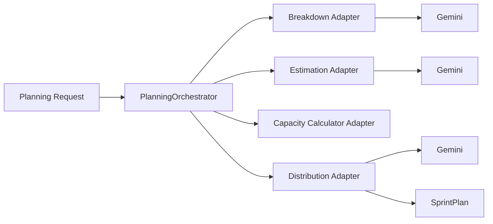
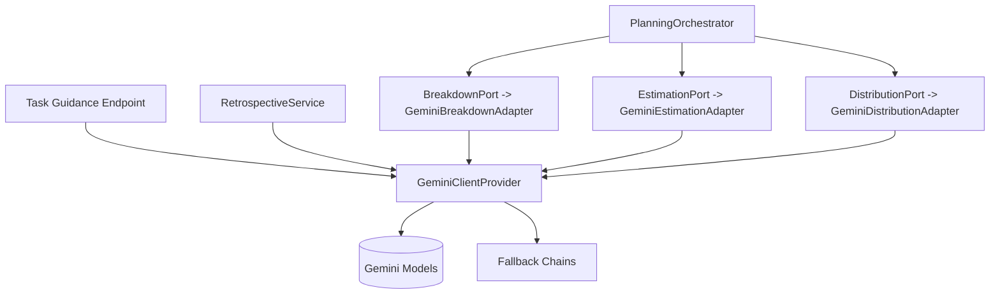

# AI Architecture

## 1) Overview

Sprint Planner uses a multi-stage AI pipeline centered on Google Gemini adapters to transform sprint intent into assignable work.

- **Primary AI scope**:
  1. Story/task breakdown
  2. Story point estimation
  3. Developer-task distribution
  4. Task-level implementation guidance
  5. Sprint retrospective narrative generation
- **Execution model**: synchronous request/response calls with fallback models.

---

## 2) AI Components

## Core provider

- `infrastructure/ai/GeminiClientProvider`
  - Owns GenAI client initialization (`google-genai` SDK)
  - Exposes `generate(prompt, temperature, preferredModel)`
  - Applies model fallback chains
  - Classifies retryable errors (429/503/quota/rate-limit, etc.)

## Pipeline adapters (ports)

- `GeminiBreakdownAdapter` implements `BreakdownPort`
- `GeminiEstimationAdapter` implements `EstimationPort`
- `GeminiDistributionAdapter` implements `DistributionPort`

All three are `@Primary`, so they are active by default over stub adapters.

## Supporting AI use-cases

- Task guidance endpoint in `SprintPlannerController` calls Gemini directly for actionable hints and risk flags.
- `RetrospectiveService` calls Gemini for narrative analysis of completed sprints.

---

## 3) Model Strategy

Configured model constants in `GeminiClientProvider`:

- Breakdown: `gemini-3-flash-preview` (with fallback to `gemini-2.5-flash`)
- Estimation: `gemini-2.5-flash-lite` (fallback `gemini-2.5-flash`)
- Distribution: `gemini-2.5-flash` (fallback `gemini-2.5-flash-lite`)

### Reliability pattern

- Each generation request iterates through model fallback chain until success.
- Retryability is inferred from error message patterns.
- Non-retryable errors fail fast.

---

## 4) End-to-End Planning AI Flow

## Detailed flow

1. **Context assembly**
   - Team profile memory + sprint history memory loaded.
   - Optional previous sprint free-text context can be injected.
   - Optional carryover tasks can be appended.
   - Optional sprint `codebaseContext` can be provided and used in planning/guidance prompts.

2. **Breakdown phase**
   - Input: epics + memory context + total capacity + per-role capacity budget + uncovered capability set + optional codebase context.
   - Output: user stories and initial tasks.

3. **Estimation phase**
   - Input: generated task list + historical context.
   - Output: task/story point estimates with size-classification framing (`XS/S/M/L/XL`) and reasoning.

4. **Distribution phase**
   - Input: estimated tasks + per-developer capacity + capabilities.
   - Output: assignment decisions and `assignmentReason` text.
   - Uses LLM preference ranking + deterministic capability/capacity checks, then second-pass gap fill.
   - Cross-capability fallback is applied when no direct role coverage exists (for selected role types).

5. **Post-processing**
   - Backend persists sprint data and computes confidence forecast from historical completion rates.

---

## 5) AI Inputs and Memory Context

AI prompts are enriched using:

- Team-level preferences (`team_memory`, file type `profile`)
- Sprint history (`team_memory`, file type `history`)
- Team composition (developers, capabilities, base velocity)
- Sprint-level constraints (days off, sprint goal, domain override)
- Optional carryover tasks from prior sprint
- Optional codebase context captured during planning

This creates a pseudo-RAG style context injection pattern, but from internal DB memory rather than external vector retrieval.

---

## 6) Secondary AI Endpoints

## Task guidance (`POST /api/sprints/{sprintId}/tasks/{taskId}/guidance`)

- Prompt includes task details, assignee context, team preferences, sprint history, and stored sprint `codebase_context`.
- Expected structured response:
  - `hints`
  - `suggestedApproach`
  - `riskFlags[]`
- If JSON parse fails, raw model output is still returned as `hints` fallback.

## Retrospective generation (`GET /api/sprints/{sprintId}/retrospective`)

- `RetrospectiveService` computes metrics/patterns and asks Gemini for narrative commentary.
- Result is cached in `sprint_review.retrospective_report` to avoid repeated AI calls.

---

## 7) Prompting and Control Characteristics

- Prompt templates are explicit and task-scoped.
- Breakdown prompts now include role-budget and uncovered-role constraints to reduce invalid role-tag generation.
- Estimation prompts explicitly ask for size classification before Fibonacci point assignment.
- Temperature is controlled per use-case through provider calls.
- Outputs are expected to be JSON in multiple use-cases, then parsed/mapped into DTOs.
- Defensive post-processing strips markdown fences before JSON parse.

---

## 8) Non-AI Fallbacks and Degradation

- Stub adapters exist for breakdown/estimation/distribution.
- They are currently inactive but can be enabled by changing `@Primary` usage.
- Distribution logic contains local fallback behavior when AI output is malformed.

This gives the system a partial degraded mode for resilience and local development.

---

## 9) Risks and Improvement Opportunities

- Breakdown primary model identifier may be unavailable depending on Gemini release/support window.
- Progress reporting is polling-based and in-memory; long calls can degrade UX during backend restarts.
- JSON parse robustness can be improved with stricter schemas or function-calling style outputs.
- Centralized prompt versioning and evaluation harness would improve reproducibility.

---

## 10) AI Architecture Snapshot

---

## 11) Architectural Positioning

In this system, AI is not an isolated sidecar. It is a first-class infrastructure capability behind domain ports, with deterministic orchestration in the application layer and strict persistence/audit on the backend side. This keeps the business flow controllable while still leveraging LLM flexibility where it adds the most value.

