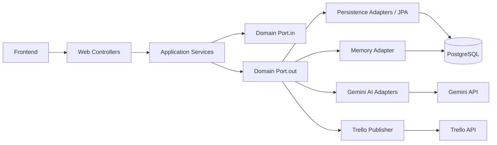

# Backend Architecture

## 1) Overview

Sprint Planner backend is a Spring Boot 3.5.14 (Java 21) service organized in a ports-and-adapters (hexagonal) architecture.

- **Core role**: authenticate users, manage teams/sprints/reviews, orchestrate AI planning, persist outcomes, expose REST APIs.
- **Primary architectural style**: domain-centric with clear inbound/outbound ports.
- **Persistence**: PostgreSQL with Flyway migrations (`V1` to `V12`).
- **Security**: stateless JWT + Spring Security filter chain.

---

## 2) Layered Structure (Hexagonal)

```text
web (controllers, HTTP DTOs)
  -> application (use-case orchestration/services)
    -> domain (entities, DTOs, ports, pure services)
      -> infrastructure (JPA adapters, AI adapters, auth, external integrations)
```

### Inbound adapters

- `web/*Controller.java` classes receive HTTP requests.
- `PlanningInputPort` is invoked by `SprintPlannerController` to start planning.

### Outbound adapters

- `infrastructure/persistence/*` implements repository ports.
- `infrastructure/ai/*` implements breakdown/estimation/distribution ports.
- `infrastructure/memory/JpaMemoryAdapter` implements memory read/write ports (active `@Primary`).
- `infrastructure/publisher/TrelloPlanPublisher` publishes approved plans to Trello.

---

## 3) Key Modules and Responsibilities

## `web`

- `SprintPlannerController`: planning, approve, plan retrieval, progress status, confidence endpoint, Trello push, delete sprint, retrospective, task guidance.
- `TeamController`: team/developer management, memory endpoints, Trello board linking, carryover tasks.
- `ReviewController`: sprint close submission endpoint.
- `ProfileController`, `DashboardController`, `AuthController`, `AdminController`: profile, dashboard, auth, admin operations.

## `application`

- `PlanningOrchestrator`: 4-phase pipeline coordinator (capacity -> breakdown -> estimation -> distribution), role-based capacity budget derivation, and uncovered-capability detection for prompt constraints.
- `SprintReviewService`: marks task completion, persists review/dev completion, completes sprint, updates sprint history.
- `ConfidenceCalculator`: computes completion probability and recommended defer points from historical data.
- `RetrospectiveService`: builds retrospective analytics and AI narrative.
- `PreferenceService`: updates team preferences from edit logs.
- `ReferenceBuilder`: updates sprint history memory.

## `domain`

- `model`: JPA entities (`Sprint`, `UserStory`, `Task`, `SprintReview`, etc.).
- `dto`: transport between layers (`PlanningRequest`, `SprintPlan`, `RetrospectiveReport`, etc.).
- `port.in` and `port.out`: abstractions to decouple use-cases from infrastructure.
- `service`: pure domain algorithms (`CapacityCalculator`, `CapabilityInferenceService`).

## `infrastructure`

- `persistence`: JPA repositories/adapters.
- `auth`: JWT creation/validation + request filter.
- `ai`: Gemini provider and planning adapters.
- `capacity`: adapter wrapping domain capacity algorithm.
- `memory`: DB-backed memory adapter (`team_memory` table).
- `progress`: in-memory planning progress store for frontend polling.
- `external` + `publisher`: Trello client and publishing logic.

---

## 4) Data and Persistence

## Main Entities

- `app_user`: identity, role, password hash, per-user Trello token.
- `team`: ownership, domain, sprint length, optional Trello board.
- `developer`: role/capabilities/base velocity.
- `sprint`: lifecycle (`PLANNING`, `ACTIVE`, `COMPLETED`; `IN_REVIEW` exists but unused) plus optional `codebase_context` (V12) stored per sprint.
- `user_story`, `task`: planning output and execution data.
- `sprint_review`, `dev_completion`: close results and per-developer stats.
- `edit_log`: manual changes recorded during review.
- `team_memory`: profile/history memory content by team.

## Migration strategy

- Flyway versioned SQL migrations in `src/main/resources/db/migration`.
- Notable recent schema additions:
  - V9: `team_memory`
  - V10: `task.assignment_reason`
  - V11: `sprint_review.retrospective_report`
  - V12: `sprint.codebase_context`

---

## 5) Request Lifecycle (High-Level)

## Planning (`POST /api/sprints/plan`)

1. HTTP request enters `SprintPlannerController`.
2. Request mapped into `PlanningRequest` (including optional `codebaseContext`) and sent to `PlanningOrchestrator`.
3. Orchestrator executes 4 phases via ports:
   - Capacity (with historical per-developer completion-rate weighting when data exists)
   - Breakdown (with capability budgets + uncovered role constraints + optional codebase context)
   - Estimation (size classification guidance -> Fibonacci points)
   - Distribution (preference ranking + capability/capacity checks + cross-capability fallback)
4. Controller persists generated sprint graph (`Sprint` + stories + tasks).
5. Controller stores `codebaseContext` on sprint (`sprint.codebase_context`) when provided.
6. Controller computes confidence forecast and embeds it in response.

## Review close (`POST /api/reviews`)

1. `ReviewController` delegates to `SprintReviewService`.
2. Service sets task statuses DONE/NOT_DONE.
3. Saves `SprintReview` and `DevCompletion` records.
4. Moves sprint to `COMPLETED` and updates sprint history memory.

## Retrospective (`GET /api/sprints/{id}/retrospective`)

1. Controller checks cached report in `sprint_review.retrospective_report`.
2. If missing, `RetrospectiveService` generates report and AI narrative.
3. JSON is cached for subsequent fast reads.

---

## 6) Security Architecture

- JWT token issued at login/register (`AuthController` + `JwtServiceImpl`).
- `JwtAuthFilter` validates bearer token and sets `SecurityContextHolder` principal/authorities.
- `SecurityConfig` permits auth/health endpoints and protects all other APIs.
- Authorization checks are implemented in controllers/services (e.g., owner checks, admin-only endpoints).

---

## 7) Integration Boundaries

- **AI boundary**: through `BreakdownPort`, `EstimationPort`, `DistributionPort` plus direct Gemini calls for guidance/retrospective; guidance prompts now also consume stored sprint `codebase_context`.
- **Trello boundary**: `TrelloApiClient` + `TrelloPlanPublisher`; requires team board link and user Trello token.
- **Memory boundary**: `MemoryReader`/`MemoryWriter` implemented by DB-backed adapter (`JpaMemoryAdapter`).

---

## 8) Operational Notes and Risks

- Planning progress is in-memory (`PlanningProgressStore`), so restart clears state.
- `CapacityCalculatorAdapter` now applies weighted historical completion-rate inputs when review data is available; teams without history still rely on baseline assumptions.
- `SprintPlannerController` has a large constructor and broad responsibility surface.
- Several dead/empty stub files exist (useful cleanup candidates for maintainability).

---

## 9) Architecture Snapshot



