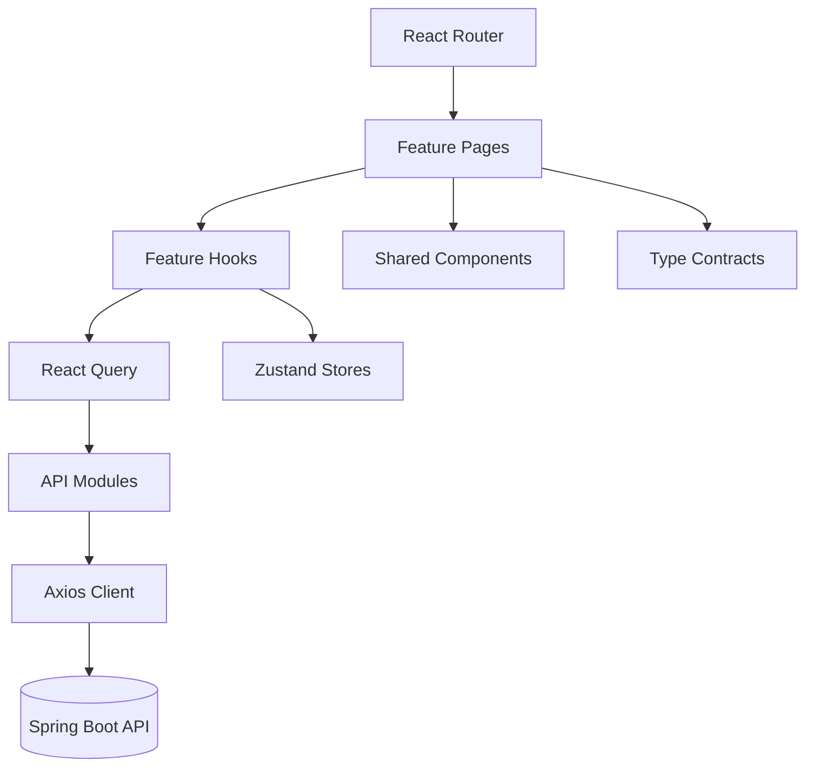

# Frontend Architecture

## 1) Overview

Sprint Planner frontend is a React 18 + TypeScript SPA built with Vite.

- **Purpose**: authentication, team setup, sprint planning/review/close workflows, profile/memory viewing, dashboards.
- **State strategy**:
  - Server state: TanStack React Query
  - Client/session state: Zustand stores
- **Routing**: React Router v6 with protected routes
- **Styling**: Tailwind CSS

---

## 2) Frontend Stack

- React 18 (`react`, `react-dom`)
- TypeScript 5
- Vite 5 build/dev server
- React Query 5 for asynchronous server state
- Zustand for auth/planning/review stores
- Axios for HTTP transport and interceptors
- React Hook Form for form handling
- React Markdown + remark-gfm for memory rendering

---

## 3) Source Organization

```text
frontend/src
  api/          -> HTTP clients and API wrappers
  components/   -> shared reusable UI
  features/     -> page-level and domain-level modules
  hooks/        -> reusable data hooks
  store/        -> Zustand slices
  types/        -> shared TypeScript contracts
  router.tsx    -> route map
```

## Feature-based modules

- `auth`: login/signup/Trello callback
- `dashboard`: overview cards/tables
- `team-setup`: team + developer management
- `planning`: sprint input flow + confidence forecast + codebase context + structured/bulk epic editing
- `review`: drag/drop review and approval flow
- `sprint-close`: task completion + retrospective access
- `profile`: profile update, stats, memory viewer
- `faq`, `landing`, `onboarding`: ancillary UX flows

---

## 4) Routing and Access Control

Route definitions are centralized in `frontend/src/router.tsx`.

- Public: `/`, `/login`, `/signup`, `/faq`, `/trello/callback`
- Protected via `ProtectedRoute`:
  - `/dashboard`
  - `/teams`
  - `/teams/:teamId/plan`
  - `/sprints/:sprintId/review`
  - `/sprints/:sprintId/close`
  - `/sprints/:sprintId/retrospective`
  - `/profile`
  - `/onboarding`

Authentication guard reads `authStore.isAuthenticated` and redirects to `/login`.

---

## 5) Data Access Layer

## Axios base client (`api/axios.ts`)

- Base URL: `VITE_API_BASE_URL` fallback `http://localhost:8080`
- Adds `Authorization: Bearer <token>` from Zustand auth store
- On HTTP 401: logs out and redirects to login
- Request timeout: 300s

## API modules

- `authApi.ts`: login/register
- `teamApi.ts`: teams/developers/Trello board links
- `sprintApi.ts`: planning/review/retrospective related sprint endpoints (planning request now supports optional `codebaseContext`)
- `reviewApi.ts`: close submission and edit logging
- `profileApi.ts`: profile, stats, team memory, Trello account status

## Mock mode behavior

- Controlled by `VITE_USE_REAL_API === 'true'`
- If not true, many APIs use localStorage/sample data instead of backend
- Useful for UI-only development; risky if enabled unintentionally in QA/staging

---

## 6) State Management

## Zustand stores

- `authStore`: token, user identity, role, login/logout, persistence enabled
- `planningStore`: selected team and current sprint IDs, persistence enabled
- `reviewStore`: in-memory edit/defer/warning UI state (not persisted)

## React Query usage

- Feature hooks (`usePlanning`, `useReview`, `useTeamSetup`, `useProfile`, `useSprintClose`) encapsulate queries/mutations
- Polling is used for planning progress updates (`/api/sprints/plan/status`)
- Retrospective page fetches and caches report data for display

---

## 7) Core UX Flows

## Planning flow

1. `PlanningPage` collects team goal, epics, days-off, previous-sprint context, optional carryover tasks, and optional `codebaseContext`.
2. Epic input supports two entry modes via `EpicInput`: structured `Cards` editing and `Paste` parsing for multiple plain-text formats.
3. `usePlanning` submits request and polls planning status.
4. `ConfidenceForecast` renders forecast returned with the plan.
5. Plan transitions user to review/dashboard flow.

## Review flow

1. `ReviewPage` loads sprint plan and developers.
2. Tasks are moved between developer lanes via drag/drop.
3. Edits are logged to backend.
4. Approval and Trello push are triggered by explicit actions.

## Sprint close flow

1. `SprintClosePage` captures completion flags + goal result + blockers.
2. Close request submits review data.
3. UI provides navigation to `RetrospectivePage`.

## Retrospective flow

- `RetrospectivePage` renders summary, developer metrics, patterns, recommendations, and AI narrative.

---

## 8) Type Contracts

- `types/planning.ts`: planning inputs/results including confidence, carryover, and optional `codebaseContext` types
- `types/sprint.ts`: sprint/story/task data model contracts
- `types/team.ts`: team/developer/domain/capability types
- `types/dashboard.ts`: dashboard response shape

Contracts closely mirror backend DTOs and reduce runtime mapping overhead.

---

## 9) Shared UI Components

Reusable components in `components/shared` include:

- Layout/navigation primitives (`PageLayout`, `Navbar`, `ProtectedRoute`)
- User-feedback components (`ErrorBanner`, `LoadingSpinner`, `NoticeBanner`)
- Interaction helpers (`ConfirmDialog`, `HelpTooltip`)

This keeps feature pages focused on behavior rather than low-level UI plumbing.

---

## 10) Architecture Snapshot



---

## 11) Practical Notes

- Mock mode is intentionally built in; ensure `VITE_USE_REAL_API=true` when validating backend integration.
- Local persistence in auth/planning stores helps resume context across reloads.
- Sprint ID normalization logic in `sprintApi.ts` improves robustness when URLs include extra text around UUIDs.
- `DashboardPage` card/button layout has recent responsive tweaks to improve small-screen behavior in active sprint and team sections.

