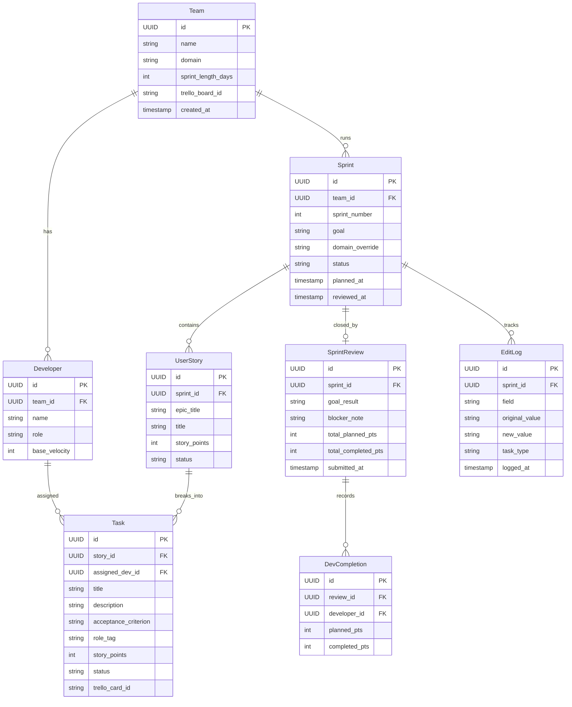

# Project Map

This map summarizes the repository structure, key responsibilities, entry points, and the database ERD so you can orient without opening files.

## Project Structure

### Backend (Spring Boot, Java 21)

src/main/java/com/sprintplanner/
├── SprintPlannerApplication.java
├── application/
│   ├── PlanningOrchestrator.java
│   ├── TeamService.java
│   ├── SprintReviewService.java
│   ├── ProfileService.java
│   ├── PreferenceService.java
│   └── ReferenceBuilder.java
├── domain/
│   ├── dto/
│   ├── model/
│   ├── port/
│   │   ├── in/
│   │   └── out/
│   └── service/
│       └── CapacityCalculator.java
├── infrastructure/
│   ├── ai/
│   ├── auth/
│   ├── config/
│   ├── external/
│   ├── memory/
│   ├── persistence/
│   └── publisher/
└── web/
    ├── SprintPlannerController.java
    ├── TeamController.java
    ├── ReviewController.java
    ├── ProfileController.java
    ├── SecurityUtils.java
    ├── auth/
    │   └── AuthController.java
    └── cli/
        └── CliRunner.java

src/main/resources/
└── db/
    └── migration/

### Frontend (Vite + React + TS)

frontend/src/
├── main.tsx
├── router.tsx
├── api/
│   ├── axios.ts
│   ├── authApi.ts
│   ├── profileApi.ts
│   ├── reviewApi.ts
│   ├── sprintApi.ts
│   └── teamApi.ts
├── components/
│   └── shared/
│       ├── ConfirmDialog.tsx
│       ├── ErrorBanner.tsx
│       ├── LoadingSpinner.tsx
│       ├── NoticeBanner.tsx
│       ├── PageLayout.tsx
│       └── ProtectedRoute.tsx
├── features/
│   ├── auth/
│   │   ├── LoginPage.tsx
│   │   ├── SignupPage.tsx
│   │   └── AuthLayout.tsx
│   ├── team-setup/
│   │   ├── TeamSetupPage.tsx
│   │   ├── DeveloperForm.tsx
│   │   └── useTeamSetup.ts
│   ├── planning/
│   │   ├── PlanningPage.tsx
│   │   ├── EpicInput.tsx
│   │   ├── DomainSelector.tsx
│   │   └── usePlanning.ts
│   ├── review/
│   │   ├── ReviewPage.tsx
│   │   ├── TaskCard.tsx
│   │   ├── DeveloperLane.tsx
│   │   ├── MismatchWarning.tsx
│   │   └── useReview.ts
│   └── sprint-close/
│       ├── SprintClosePage.tsx
│       ├── TaskCompletionToggle.tsx
│       └── useSprintClose.ts
├── hooks/
│   ├── useDebounce.ts
│   ├── useProfile.ts
│   └── useTeamMemory.ts
├── lib/
│   └── utils.ts
├── store/
│   ├── authStore.ts
│   ├── planningStore.ts
│   └── reviewStore.ts
└── types/
    ├── planning.ts
    ├── sprint.ts
    └── team.ts

### Supporting Docs

- AGENT_CONTEXT.md (backend architecture, data models)
- frontend/AGENT_CONTEXT_FRONTEND.md (frontend architecture)
- additional/sprint_planner_data_models.html (Mermaid ERD source)

## Responsibility Comments

### Backend

`src/main/java/com/sprintplanner/SprintPlannerApplication.java`
→ Spring Boot entry point and component scanning configuration
→ Enables JPA repositories, entity scanning, and Gemini config properties

`src/main/java/com/sprintplanner/web/SprintPlannerController.java`
→ Handles sprint plan endpoints: plan, fetch, approve, edit logging
→ Builds `PlanningRequest` and delegates to `PlanningInputPort`
→ Persists `Sprint` and related `UserStory`/`Task` aggregates

`src/main/java/com/sprintplanner/web/TeamController.java`
→ Handles team CRUD and developer management endpoints
→ Enforces access with `SecurityUtils` and delegates to `TeamService`
→ Exposes memory read/clear endpoints (`team_profile.md`, `sprint_history.md`)

`src/main/java/com/sprintplanner/web/ReviewController.java`
→ Handles sprint review submission endpoint
→ Delegates review close flow to `SprintReviewService`

`src/main/java/com/sprintplanner/web/ProfileController.java`
→ Provides profile read/update endpoints for the current user
→ Delegates to `ProfileService` for profile and stats

`src/main/java/com/sprintplanner/web/auth/AuthController.java`
→ Handles login and registration endpoints
→ Uses `JwtService` to generate tokens and `JpaUserRepository` for persistence

`src/main/java/com/sprintplanner/web/cli/CliRunner.java`
→ CLI entry point for planning from JSON files
→ Converts input into `PlanningRequest` and publishes via `PlanPublisher`

`src/main/java/com/sprintplanner/application/PlanningOrchestrator.java`
→ Orchestrates the planning pipeline across Breakdown, Estimation, Capacity, Distribution ports
→ Loads team and memory context for LLM prompts and capacity calculation

`src/main/java/com/sprintplanner/application/TeamService.java`
→ Team and developer lifecycle operations with access checks
→ Infers developer capabilities from role labels

`src/main/java/com/sprintplanner/application/SprintReviewService.java`
→ Closes a sprint: task completion, totals, per-dev completions, review persistence
→ Marks sprint status as COMPLETED and attaches `SprintReview`

`src/main/java/com/sprintplanner/application/ProfileService.java`
→ Builds user profile and aggregate stats (velocity, goal hit rate)
→ Aggregates data across teams and sprints

`src/main/java/com/sprintplanner/application/PreferenceService.java`
→ Rebuilds `team_profile.md` from edit logs
→ Writes preference memory via `MemoryWriter`

`src/main/java/com/sprintplanner/application/ReferenceBuilder.java`
→ Rebuilds `sprint_history.md` from recent reviews
→ Keeps a rolling window of latest three reviews

`src/main/java/com/sprintplanner/domain/service/CapacityCalculator.java`
→ Pure domain algorithm for per-developer capacity (no Spring, no LLM)
→ Applies days-off and completion-rate adjustments

### Frontend

`frontend/src/main.tsx`
→ App entry point: React root, QueryClientProvider, RouterProvider

`frontend/src/router.tsx`
→ Route definitions and protected route gating
→ Maps URL paths to feature pages

`frontend/src/api/axios.ts`
→ Axios instance configuration, base URL, interceptors

`frontend/src/api/authApi.ts`
→ Authentication API calls (`/api/auth/login`, `/api/auth/register`)

`frontend/src/api/teamApi.ts`
→ Team and developer API calls (`/api/teams`, `/api/teams/:id/developers`)

`frontend/src/api/sprintApi.ts`
→ Planning and sprint approval API calls (`/api/sprints/*`)

`frontend/src/api/reviewApi.ts`
→ Review submission and edit logging API calls (`/api/reviews`, `/api/sprints/:id/edits`)

`frontend/src/api/profileApi.ts`
→ Profile data and stats API calls (`/api/profile`, `/api/profile/stats`)

`frontend/src/features/team-setup/TeamSetupPage.tsx`
→ Team listing, create team, add/remove developers

`frontend/src/features/planning/PlanningPage.tsx`
→ Epics input, domain selection, sprint goal, days-off input, plan generation

`frontend/src/features/review/ReviewPage.tsx`
→ Review sprint plan, edit tasks, reassign work, approve plan

`frontend/src/features/sprint-close/SprintClosePage.tsx`
→ Mark tasks done/not done and submit sprint review

`frontend/src/features/auth/LoginPage.tsx`
→ User login form and auth submission

`frontend/src/features/auth/SignupPage.tsx`
→ User registration form and account creation

`frontend/src/store/planningStore.ts`
→ UI state for active planning session (selected team and sprint IDs)

`frontend/src/store/reviewStore.ts`
→ UI state for review edits, deferred tasks, dismissed warnings

## Database Diagram (Mermaid ERD)

## Important Entry Points

### Backend

Application startup:
`src/main/java/com/sprintplanner/SprintPlannerApplication.java`
→ Spring Boot auto-configuration
→ JPA + config bootstrap

Planning flow (HTTP):
`src/main/java/com/sprintplanner/web/SprintPlannerController.java`
→ `PlanningInputPort` (`PlanningOrchestrator`)
→ `BreakdownPort` → `EstimationPort` → `CapacityPort` → `DistributionPort`
→ `SprintRepository` persistence

Team management:
`src/main/java/com/sprintplanner/web/TeamController.java`
→ `TeamService` → `TeamRepository` + `DeveloperRepository`
→ `MemoryReader` / `MemoryWriter` for team memory files

Review/close flow:
`src/main/java/com/sprintplanner/web/ReviewController.java`
→ `SprintReviewService` → `SprintRepository` + review repositories

Auth flow:
`src/main/java/com/sprintplanner/web/auth/AuthController.java`
→ `JwtService` + `JpaUserRepository`

CLI flow:
`src/main/java/com/sprintplanner/web/cli/CliRunner.java`
→ `PlanningInputPort` → `PlanPublisher`

### Frontend

Routing entry:
`frontend/src/router.tsx`
→ `/teams` → `TeamSetupPage`
→ `/teams/:teamId/plan` → `PlanningPage`
→ `/sprints/:sprintId/review` → `ReviewPage`
→ `/sprints/:sprintId/close` → `SprintClosePage`
→ `/login` → `LoginPage`
→ `/signup` → `SignupPage`

Data access:
`frontend/src/api/*.ts`
→ `axios.ts` (base client)
→ Feature hooks call API wrappers (React Query)

## Tree Output (Depth 3)

Generated from `find . -maxdepth 3 -print` (tree is not installed). Build artifacts and dependencies are omitted.

.
├── AGENT_CONTEXT.md
├── AGENT_CONTEXT_PHASE2 (1).md
├── PROJECT_MAP.md
├── additional/
│   ├── 8mayerrors.txt
│   ├── checkthis.txt
│   ├── input.txt
│   ├── plan.txt
│   ├── sprint_planner_architecture_v2.docx
│   ├── sprint_planner_architecture_v2.pdf
│   ├── sprint_planner_data_models.html
│   ├── sprint_planner_io_boundaries.jpg
│   └── vagueepicsolutions.txt
├── compose.yaml
├── frontend/
│   ├── AGENT_CONTEXT_FRONTEND.md
│   ├── index.html
│   ├── package.json
│   ├── postcss.config.cjs
│   ├── tailwind.config.ts
│   ├── tsconfig.json
│   ├── vite.config.ts
│   └── src/
├── memory/
│   └── <team-id>/{team_profile.md,sprint_history.md}
├── mvnw
├── mvnw.cmd
├── pom.xml
└── src/
    ├── main/
    │   ├── java/
    │   └── resources/
    └── test/
        └── java/
