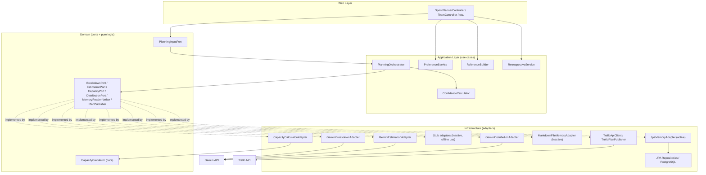

# Sprint Planner

AI-assisted sprint planning: give it your team, your backlog epics, and a sprint goal, and it runs a multi-stage Gemini pipeline to break epics into estimated tasks and assign them to developers by capability and capacity — then hands the plan to a PM for review, editing, and approval before it's pushed to Trello.

Built as a second graduation project to go deeper on multi-stage AI system design in a real full-stack product, rather than a toy notebook demo.

**On "AI agents":** the pipeline is a **sequential, orchestrated set of specialized AI calls** (breakdown → estimation → distribution), each a single request/response to Gemini with its own prompt, schema, and fallback model chain — not autonomous agents that loop, call tools, or call each other. `PlanningOrchestrator` is the one place that decides what happens next; the AI adapters don't have agency beyond returning structured output for the step they were called for. If you're looking for ReAct-style tool-using agents, this isn't that — it's a deterministic pipeline with LLM calls at specific, bounded points.

---

## Architecture

The backend follows hexagonal (ports-and-adapters) architecture. The reason isn't academic: **the AI provider is the most volatile dependency in this system.** Gemini model names get deprecated, response formats shift, and at some point you'll want to swap providers or add a stub for offline development. Every AI call sits behind a domain-owned port (`BreakdownPort`, `EstimationPort`, `DistributionPort`, `CapacityPort`), and the concrete implementation — a Gemini adapter today — is swapped in via Spring's `@Primary`. Stub adapters implementing the same ports already exist for offline/local use (they're just not wired as primary).

The same pattern applies to persistence and memory (`MemoryReader`/`MemoryWriter` — currently a JPA-backed adapter, with an inactive filesystem adapter still in the codebase) and to Trello (`PlanPublisher`).



### The AI pipeline (`PlanningOrchestrator`)

Four stages, run in sequence, orchestrated in application code — not by the model:

1. **Capacity** — `CapacityCalculatorAdapter` computes each developer's available points (`baseVelocity × availability × completionFactor`), where `completionFactor` is a weighted average of that developer's actual completion rate from past sprint reviews (new teams get a 0.80 fresh-start factor instead).
2. **Breakdown** — `GeminiBreakdownAdapter` turns epics into user stories and tasks in one batch call, given per-role capacity budgets, uncovered-capability warnings, team composition, memory context, and optional codebase context.
3. **Estimation** — `GeminiEstimationAdapter` classifies each task XS–XL with a one-line rationale, then maps that to Fibonacci story points, in one batch call.
4. **Distribution** — `GeminiDistributionAdapter` assigns tasks to developers. This is the most involved stage (see Features below).

Carry-over tasks (unfinished work from the previous sprint) are pulled out before distribution, kept with their original assignee, and merged back into the final plan afterward so they don't compete with new work for capacity.

### Reliability pattern (what's actually implemented)

`GeminiClientProvider` is the single chokepoint for every Gemini call. Each call site names a preferred model, which resolves to a fallback chain:

| Stage | Preferred model | Falls back to |
|---|---|---|
| Breakdown | `gemini-3.5-flash` | `gemini-2.5-flash` |
| Breakdown (retry) | `gemini-2.5-flash-lite` | `gemini-2.5-flash` |
| Estimation | `gemini-2.5-flash-lite` | `gemini-2.5-flash` |
| Distribution | `gemini-2.5-flash` | `gemini-2.5-flash-lite` |
| Retrospective narrative + task guidance | `gemini-2.5-flash-lite` | `gemini-2.5-flash` |

On a call failure:
- The error message is pattern-matched against retryable signals (`429`, `503`, `overloaded`, `quota`, `rate limit`, `unavailable`, etc.).
- If retryable, it sleeps a **flat 2 seconds** and tries the next model in the chain — this is a fallback-and-retry loop, **not exponential backoff**.
- If not retryable, it throws immediately without trying further models.
- If every model in the chain fails, the last exception is re-thrown.

Structured pipeline calls (breakdown/estimation/distribution) additionally constrain Gemini via SDK `responseSchema` + `responseMimeType("application/json")`, with markdown-fence-stripping kept as a defensive fallback in case a model still wraps its output.

### Memory system

Two distinct memory stores, both persisted in the `team_memory` Postgres table (keyed by `teamId` + a `file_type` of `"profile"` or `"history"`), read/written by `JpaMemoryAdapter`:

- **Preference Memory** (`profile`) — built by `PreferenceService`, called on sprint approval. It scans `edit_log` entries from the sprint just approved (PM's manual drag/drop reassignments, story-point edits, defer toggles) and detects recurring patterns (e.g. repeated defers of a task type, repeated point increases). Each detected pattern is stored with a `(last seen: YYYY-MM-DD)` timestamp; **patterns not re-detected within 60 days are dropped** on the next rebuild. This is genuinely edit-based and decaying — it reflects how the PM actually adjusts AI output, not sprint outcomes.
- **Reference Memory** (`history`) — built by `ReferenceBuilder`, called on sprint close. It's a rolling summary of the **last 3 completed sprint reviews** (goal result, planned vs. completed points, per-developer stats) — outcome-based, no decay logic, just a fixed 3-sprint window.

Both are injected as prompt context into the breakdown, distribution, and retrospective calls. (A filesystem-based `MarkdownFileMemoryAdapter` also exists in the codebase but isn't wired as `@Primary` — it's dead code today, kept for reference/potential future use.)

---

## Tech Stack

**Backend**
- Java 21, Spring Boot 3.5.14 (`web`, `data-jpa`, `validation`, `security`, `actuator`)
- PostgreSQL, Flyway (`V1`–`V14` migrations)
- JWT auth via `jjwt` 0.12.6 (HMAC-SHA, stateless, 24h default expiry) + BCrypt
- Google GenAI SDK (`google-genai` 1.0.0) for Gemini
- Apache PDFBox 3.0.2 and Apache POI (`poi-ooxml` 5.2.5) — PDF/Excel text extraction for codebase-context file upload
- `spring-dotenv` 4.0.0 — loads a root `.env` file into Spring's environment
- Testcontainers + JUnit for backend integration tests (Postgres container-backed)

**Frontend**
- React 18.3.1 + TypeScript 5.6.3, built with Vite 8.0.16 (requires Node `^20.19.0` or `>=22.12.0`, per Vite's own `engines` field)
- Zustand 5.0.0 (client state, localStorage-persisted where relevant)
- TanStack React Query 5.59.20 (server state/caching)
- React Router 6.28.0, React Hook Form 7.53.1
- Tailwind CSS 3.4.15 (+ `@tailwindcss/typography`)
- `react-markdown` 10.1.0 + `remark-gfm` — renders the memory viewer's markdown

**External services**
- Google Gemini API (all three pipeline stages + task guidance + retrospective narrative)
- Trello REST API (list/card creation on sprint push; per-user OAuth token)

**Infra**
- Docker Compose (`compose.yaml`) — single Postgres 16 container for local development
- Deployed on **Railway** (backend + Postgres, via Nixpacks auto-detection) and **Vercel** (frontend, via Vite auto-detection) — both platforms build straight from the repo with no committed config files (`railway.json`, `Dockerfile`, `vercel.json`), since env vars and build settings live in each platform's dashboard rather than in-repo. The backend's `PGHOST`/`PGPORT`/`PGDATABASE`/`PGUSER`/`PGPASSWORD` naming matches what Railway's Postgres plugin injects automatically, so linking the plugin wires the database with no extra mapping.

---

## Features

- **4-stage AI planning pipeline** — epics in, an assigned, estimated sprint plan out (breakdown → estimation → capacity → distribution), with a live progress log the frontend polls every 600ms.
- **Hybrid distribution algorithm** — the strongest technical piece: `GeminiDistributionAdapter` gets an LLM call to *rank developer preference* for each task given team profile/history context, but the actual assignment is applied deterministically against real capacity numbers and capability tags, with a second-pass gap-fill and cross-capability fallback (e.g. QA → backend/frontend/fullstack) when no developer directly covers a role. The LLM proposes; the code enforces capacity constraints and never lets the model itself do unconstrained bin-packing.
- **Sprint confidence forecast** — computed from weighted historical completion rates per team, shown before the PM commits to the plan (probability of completion, realistic point count, a defer recommendation).
- **AI task guidance** — on-demand, per-task hints/suggested approach/risk flags from Gemini, using stored codebase context so advice is stack-aware rather than generic.
- **Sprint retrospective** — auto-generated after sprint close (per-developer stats, detected patterns like overcommitment or declining trend, AI narrative), cached in the DB so Gemini isn't called twice for the same sprint.
- **Review page: drag-and-drop reassignment** — PM moves tasks between developer lanes; every change is logged to `edit_log` and immediately reflected in a live capacity bar per developer.
- **AI Plan vs. Final Plan comparison** — the original Gemini assignment is reconstructed from the earliest edit-log entry per task/field (not stored separately), so PMs can always see what the AI originally proposed vs. what they changed, with an "edited" badge on modified tasks.
- **Carry-over handling** — unfinished tasks from the previous sprint are surfaced, optionally pulled into the next planning run as a synthetic story, kept out of the AI distribution competition, and re-merged with their original assignee preserved.
- **Deferred tasks** — PM can mark a task deferred mid-review; it's excluded from capacity totals and the sprint-close checklist without deleting it.
- **Read-only lock after Trello push** — once a sprint goes ACTIVE/COMPLETED, the review board becomes read-only with a banner pointing to Trello as the source of truth.
- **Trello integration** — per-user OAuth-linked Trello account; pushing a sprint creates one Trello list per epic and one card per task, saving the card ID back to the task.
- **Team preference & sprint history memory** — described above; visible to the PM in a dedicated memory viewer on the Profile page.

---

## How it works — one sprint cycle

1. **Team setup** (once) — create a team, add developers with capability tags (backend/frontend/qa/devops/android/ios/fullstack) and a base velocity in story points.
2. **Planning input** — PM enters epics (structured cards or a bulk-paste parser supporting several line formats), a sprint goal, days off per developer, and optionally: codebase context (free text, reused later in task guidance), previous-sprint context (first sprint only), and carry-over tasks to include.
3. **`POST /api/sprints/plan`** → `PlanningOrchestrator`:
   - loads team profile + sprint history memory
   - computes per-developer capacity (history-weighted)
   - **breakdown**: Gemini turns epics into stories/tasks against capacity budgets and uncovered capabilities
   - **estimation**: Gemini sizes every task and maps to Fibonacci points
   - carry-over stories are split out and their capacity pre-deducted
   - **distribution**: Gemini ranks preference, code applies capacity/capability constraints and fills gaps
   - carry-over tasks are merged back in with original assignees preserved
   - a confidence forecast is computed and embedded in the response
4. **PM review** (`ReviewPage`) — drag tasks between developer lanes, see the AI's one-sentence assignment reason per task, toggle AI-vs-Final plan view, defer tasks, resolve any mismatch warnings. Every edit is logged.
5. **Approve** — sprint goes `ACTIVE`; `PreferenceService` scans this sprint's edits and updates the team's preference memory.
6. **Push to Trello** (optional, requires a linked Trello account) — creates lists/cards; review board becomes read-only.
7. **Sprint close** — PM marks tasks done/not done, records a goal result; `SprintReviewService` saves the outcome, and `ReferenceBuilder` rebuilds the rolling 3-sprint history memory. A retrospective (stats + AI narrative) is generated automatically and cached.

---

## Setup / running locally

### Prerequisites
- Java 21 (JDK)
- Node.js `^20.19.0` or `>=22.12.0` (Vite 8 requirement)
- Docker (for the bundled Postgres compose file) — or your own PostgreSQL 16 instance
- A Google Gemini API key
- (Optional, for Trello push) a Trello Power-Up API key, and a Trello account to connect in-app

### 1. Start Postgres
```bash
docker compose up -d
```
This starts Postgres 16 on `localhost:5433` with db `mydatabase` / user `user` (see `compose.yaml`; override via the env vars below if you change it).

### 2. Backend environment
Create a `.env` file in the repo root (loaded automatically via `spring-dotenv`). No real values are shown here — only the variable names:

| Variable | Required | Notes |
|---|---|---|
| `GEMINI_API_KEY` | **Yes** | No default — the app won't start meaningfully without it |
| `JWT_SECRET` | **Yes** | No default (by design) — must be a real secret, at least 32 characters |
| `CORS_ORIGIN` | **Yes** | No default in `application.properties`; set to your frontend origin, e.g. `http://localhost:5173` |
| `PGHOST` | No | Defaults to `localhost` |
| `PGPORT` | No | Defaults to `5433` |
| `PGDATABASE` | No | Defaults to `mydatabase` |
| `PGUSER` | No | Defaults to `user` |
| `PGPASSWORD` | No | Defaults to `1234` (dev-only default — change it if you're not using the bundled compose Postgres) |
| `TRELLO_API_KEY` | No | Server-side Trello REST key; optional unless you want Trello push to work |
| `TRELLO_TOKEN` | No | Legacy/global fallback — the actual push flow uses each user's own OAuth token (connected via the Profile page), not this variable |
| `JWT_EXPIRATION_MS` | No | Defaults to `86400000` (24h) |

### 3. Run the backend
```bash
./mvnw spring-boot:run
# or, to auto-seed 3 demo teams + a dev admin user:
./mvnw spring-boot:run -Dspring-boot.run.profiles=dev
```

### 4. Frontend environment
Create `frontend/.env.local` (see `frontend/.env.example` for the format):

| Variable | Required | Notes |
|---|---|---|
| `VITE_USE_REAL_API` | Recommended | Must be `"true"` to hit the real backend — **if unset, the frontend silently runs in mock mode against localStorage sample data**, which is a common source of "why isn't this calling my API" confusion |
| `VITE_API_BASE_URL` | No | Defaults to `http://localhost:8080` |
| `VITE_TRELLO_API_KEY` | No | Only needed to test the "Connect Trello" flow from Profile/Onboarding |

### 5. Run the frontend
```bash
cd frontend
npm install
npm run dev
```
Vite's dev server proxies `/api` to `http://localhost:8080` (see `vite.config.ts`).

### Getting API keys
- **Gemini**: create a key at [Google AI Studio](https://aistudio.google.com/app/apikey).
- **Trello API key**: [trello.com/power-ups/admin](https://trello.com/power-ups/admin) → create a Power-Up → API Key. A Trello *token* is not generated manually here — connect your Trello account from the app's Profile page, which runs the OAuth flow and stores a per-user token.

---

## Known limitations

- **This is a sequential pipeline, not autonomous agents.** Each stage is one bounded LLM call orchestrated by regular application code — no looping, no tool use, no agent-to-agent calls. Described plainly above rather than marketed as "agentic."
- **Planning progress is in-memory only** (`PlanningProgressStore`), cleared on backend restart. If the server restarts mid-plan, the frontend's progress poll has nothing to find and will hang.
- **Frontend defaults to mock mode.** Without `VITE_USE_REAL_API=true` set explicitly, the UI runs entirely against localStorage sample data and never touches the backend.
- **No frontend automated tests.** The backend has JUnit + Testcontainers integration tests for a handful of controllers/services and the capacity calculator; coverage is not comprehensive.
- **`Sprint.IN_REVIEW` status is defined but unreachable** — the flow goes straight `PLANNING → ACTIVE → COMPLETED`.
- **Single-team-at-a-time planning scope** — there's no cross-team or multi-project view; each sprint plan is scoped to one team.
- **Gemini model availability isn't guaranteed** — model name constants (e.g. `gemini-3.5-flash`) should be checked against your own API tier before relying on the primary (non-fallback) path.
- **`POST /api/teams/seed-sample` is non-functional.** The endpoint exists and there's a "load sample data" button wired to it in the team-setup UI, but its backing service is an empty stub, so it likely does nothing or errors at runtime.

---

## License

**All rights reserved © Kerem Göbekcioğlu, 2026.**

This repository is public for viewing and portfolio purposes only. It is **not** open-source and no license (MIT, Apache, or otherwise) is granted. You may read the code, but copying, redistribution, or derivative use of any part of it requires prior written permission from the author. See [`LICENSE`](./LICENSE) for the full text. If you'd like to use any part of this project, please reach out first.
